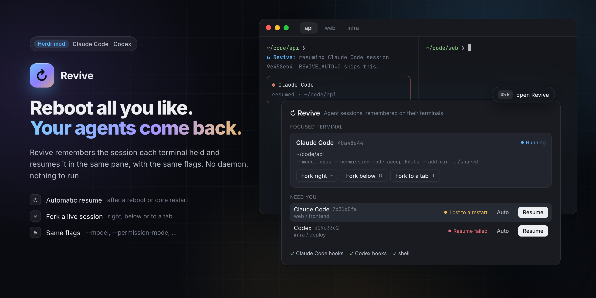

# ↻ Revive

[](https://github.com/dmazlum/herdr-revive/actions/workflows/ci.yml)

Bring back the coding agent a [Herdr](https://herdr.dev) terminal lost, and fork a live
session beside it.

Herdr keeps your terminals through app restarts and updates. When the machine reboots or
herdr-core stops, each pane comes back with a fresh shell in the same folder, but the agent
that was running there is gone. Revive remembers which session each terminal held and,
when its shell comes back, starts that session again in the same pane, with the same
flags.



Requires the **Herdr desktop app 0.1.9+**, **Node 20+**, and **Claude Code**. Codex support
is experimental.

## Features

- **Automatic resume.** After a reboot or a core restart, the pane's new shell runs
  `claude --resume <id>` (or `codex resume <id>`) in the session's folder, before you touch
  anything. A dim line says what it is doing.
- **Only what was lost.** A session you ended yourself (`/exit`, Ctrl+C, `/logout`) is
  forgotten on the spot. A session that was never sent a message is skipped, since it has
  nothing to resume. A shell you start inside a pane never resumes anything.
- **Same flags.** `--dangerously-skip-permissions`, `--model`, `--permission-mode`,
  `--add-dir` and similar flags come back with the session. The first prompt and
  `--resume` itself are left behind.
- **Fork.** Open the conversation of the focused agent as a new session beside it (right,
  below or in a new tab), with the same flags. Both work in the same folder; a fork copies
  the conversation, not the files.
- **Resume by hand.** An agent that died under a shell that survived it (a crash, a `kill`)
  is listed as *Interrupted*, with a **Resume** button. One whose resume failed is listed
  as *Resume failed*.
- **Per terminal.** Turn automatic resume off for one terminal in the dialog, or for a
  whole shell with `REVIVE_AUTO=0`.
- **Nothing to run.** No background process. Sessions are remembered as labels on their
  herdr-core terminals, so the record lives exactly as long as the terminal does.

## Install

In Herdr, ask your agent to add `github.com/dmazlum/herdr-revive`: it reads
[`RECIPE.md`](RECIPE.md) and every file, copies `mods/revive`, merges
[`keys.json`](keys.json), checks the mod and runs the install step. Or by hand:

```sh
git clone https://github.com/dmazlum/herdr-revive
cp -R herdr-revive/mods/revive ~/.config/herdr-app/mods/
herdr-app check ~/.config/herdr-app/mods/revive
node ~/.config/herdr-app/mods/revive/revive.mjs install
```

`install` adds two hooks (`SessionStart`, `SessionEnd`) to `~/.claude/settings.json` when
Claude Code is installed (`~/.claude` exists), the
same two to `~/.codex/hooks.json` when Codex is installed, and a short block to the file
your login shell reads at start: `~/.zshrc` for zsh, and for bash the first of
`~/.bash_profile`, `~/.bash_login` and `~/.profile` that exists (Herdr starts terminals as
login shells, which don't read `~/.bashrc`). zsh is asked where its `.zshrc` is, so a
`ZDOTDIR` set in `~/.zshenv` is followed. A symlinked file (a dotfiles repository) is
changed where the link points, and every file keeps its permissions. The first time it
changes a file, the original is copied to `<file>.revive-backup`; later runs keep that
copy. Running it again
changes nothing, so it is also how you update the shell block after updating Revive. The
**Install** button in the dialog does the same. Codex asks you to trust new hooks the next
time it starts.

```sh
node ~/.config/herdr-app/mods/revive/revive.mjs install --zsh --bash   # both shells
node ~/.config/herdr-app/mods/revive/revive.mjs uninstall              # take it all out
node ~/.config/herdr-app/mods/revive/revive.mjs doctor                 # what is installed
```

Then merge [`keys.json`](keys.json) into `~/.config/herdr-app/keys.json`:

| Key | What it does |
| --- | --- |
| `cmd-shift-r` → `mod.open:revive` | Open the dialog for the focused terminal |
| `F` / `D` / `T` in the dialog | Fork the focused agent right / below / to a new tab |
| `↵` in the dialog | Resume the focused terminal's session |
| `R` | Refresh |
| Esc | Close |

While developing, link the folder instead of copying it, and Herdr reloads the mod on
every save:

```sh
ln -s "$PWD/herdr-revive/mods/revive" ~/.config/herdr-app/mods/revive
```

## Updates

Herdr updates its own mods, not ones you added: yours is a copy, and nothing tells you
when this repo changes. To hear about a new version, watch the repo for releases (on
GitHub: **Watch → Custom → Releases**). Each
[release](https://github.com/dmazlum/herdr-revive/releases) says what changed and whether
`keys.json` did; merge it again when it did.

The version you have is `"version"` in `~/.config/herdr-app/mods/revive/mod.json`. To
update, ask your agent to replace that folder with the latest `mods/revive` from
`github.com/dmazlum/herdr-revive`. Adding it again isn't enough: an agent never
overwrites a mod, it would add a second copy under a new name. If the mod was renamed when
it was added (a name clash), the renamed folder is the one to replace, renamed the same way.
Or by hand:

```sh
git -C herdr-revive pull          # or clone it again
rm -rf ~/.config/herdr-app/mods/revive
cp -R herdr-revive/mods/revive ~/.config/herdr-app/mods/
herdr-app check ~/.config/herdr-app/mods/revive
node ~/.config/herdr-app/mods/revive/revive.mjs install
```

Run `install` after every update: it brings the hooks and the shell block up to date and
changes nothing when they already are.

## How it works

1. When an agent starts a session in a Herdr terminal, its `SessionStart` hook runs
   `revive.mjs hook`. That labels the terminal (`hc label`) with the agent, the session id,
   the folder, the flags worth keeping, and the pid and start time of the terminal's
   program. Only the agent in the terminal's foreground is recorded (with any wrapper
   that launches it): a `claude -p` it runs as a tool is not.
2. When the session ends, `SessionEnd` tells why. You ended it: the labels go. A signal
   ended it (reason `other`): the labels stay. `/clear` leaves them to the new session,
   which records itself.
3. After a reboot or a core restart, herdr-core gives the terminal a new shell. Its rc file
   checks, without starting anything, that a session is remembered and that it is the
   terminal's own shell, then asks `revive.mjs check`. A terminal whose program is no
   longer the remembered one (by
   pid and start time, since pids start over after a reboot) lost its agent, so `check`
   prints the commands that resume the session. The shell runs them at its first prompt,
   once its rc files are done, and hands the agent the terminal device itself, so prompt
   themes that hold the shell's output while it starts (an instant prompt) don't get in
   the way.
4. If the agent exits with an error within 15 seconds, the terminal is marked as failed and
   the dialog offers a retry. A failed session is not tried again automatically.

```sh
hc get t3 --json | jq '.labels | with_entries(select(.key | startswith("revive.")))'
hc label t3 revive.auto=off      # no automatic resume for t3
REVIVE_DEBUG=1 zsh               # say why a shell did or didn't resume
```

## Limits

- Local only. Terminals on another machine are not remembered yet.
- Sessions started before Revive was installed have no record. The dialog still finds a
  running Claude Code session through its pid, so it can be forked, but it won't come
  back by itself.
- An agent that died while its shell lived on is not resumed automatically, since nothing
  told the shell. Use **Resume** in the dialog.
- Codex support is experimental. Its hooks follow the same format as Claude Code's,
  and Codex behind a wrapper (npm's `node …/bin/codex`, a launcher script) is recognized,
  but Revive can't check whether a Codex session can be resumed before trying. Codex
  0.163.0 also runs its sessions in a shared background daemon, which Revive was not
  built for:
  - `SessionEnd` always reports reason `other`, so Revive can't tell a session you ended
    from one a crash or a restart ended. A session you left with `/quit` stays
    remembered, shows as *Interrupted*, and comes back at the next restart. To stop that,
    turn automatic resume off for that terminal in the dialog.
  - `/quit` sends no `SessionEnd`. When the daemon stops (its pane closes), it sends one
    for every session it held.
  - The daemon, not the terminal's Codex process, runs the hooks, so they can't tell which
    terminal a session is in, and a session it runs is not recorded. The dialog still
    shows the running Codex, without Fork. To have Codex sessions recorded, run Codex
    without the daemon: `daemon_auto_start = false` under `[features]` in
    `~/.codex/config.toml`. Codex warns that this can turn off features for other apps that
    share the daemon.
  - Codex fires `SessionStart` at a session's first message, so a session is recorded
    only from then.
- Shell support: zsh and bash. Other shells can run `revive.mjs check --shell $$` from
  their own rc file and evaluate what it prints.

## Development

```sh
npm test    # labels, states, flags, quoting, the resume script, install and uninstall
```

The UI is checked in Herdr: `herdr-app check`, then `herdr-app shot` while the dialog is
open. To test a real restart without touching your own terminals, start a second
herdr-core with its own `HC_SESSION` and `XDG_STATE_HOME`/`XDG_RUNTIME_DIR` (a short path:
socket paths are limited to about 100 bytes) and restart that one.

## License

MIT
